# Algorithm Flowchart

This flowchart mirrors the actual implementation in `src/`. Function names in `code font` are the
callables that perform each step; branch conditions are the exact rules implemented.

```mermaid
flowchart TD
    A["Input SEM image<br/>PNG / TIFF / JPEG"] --> B["load_image()<br/>validate path & format<br/>preserve original array<br/>16-bit preserved then mapped to 0..255"]
    B --> C{"preprocessing.enabled ?"}
    C -- no --> D["gray = original<br/>(paper applies none)"]
    C -- yes --> C1["preprocess()<br/>median -> gaussian -> percentile stretch"]
    C1 --> D
    D --> E["binned_histogram(gray, w)"]
    E --> F["global_threshold()<br/>drop extreme low/high bands<br/>th = mu + 2*sigma"]
    F --> G["binary = gray > th"]
    G --> H["thin()  (skeletonize)<br/>one-pixel boundary"]
    H --> I["gradient_direction()<br/>Sobel direction folded to [0, pi)"]
    I --> J["link_edges()<br/>ends matched by closest direction<br/>k = 5 -> 7, iterate, re-thin"]
    J --> K["label_regions()<br/>region growing from free pixels<br/>prune open curves<br/>boundary px -> nearest region"]
    K --> L["initial labels 1..N + areas"]
    L --> M["region_area_statistics()<br/>mu_S, sigma_S  (border excluded)"]
    M --> N{"S_i > mu_S + sigma_S ?"}
    N -- no --> O["region kept as-is"]
    N -- yes --> P["local_threshold()<br/>T_local = mu_l + 0.5*sigma_l<br/>within the region only"]
    P --> Q["thin -> link (k = 3) -> label_regions<br/>inside the region"]
    Q --> R["split into pieces<br/>(no split -> keep whole)"]
    O --> S["refined labels"]
    R --> S
    S --> T["detect_void_tips()<br/>binned histogram, first local max<br/>I_t = upper bound of that bin"]
    T --> U{"local maximum found ?"}
    U -- no --> U1["status = failure reason<br/>I_t = None<br/>warn; no VOID regions possible"]
    U -- yes --> V["tip_mask = gray < I_t"]
    V --> W{"region contains tip ?"}
    W -- no --> X["region: no void pixel"]
    W -- yes --> Y["extension_threshold()<br/>I_v = max(mu_l - 0.5*sigma_l, I_t)"]
    Y --> Z["void pixels = region AND gray < I_v"]
    Z --> AA["extended void mask"]
    U1 --> AB
    X --> AB["classify_regions()"]
    AA --> AB
    AB --> AC{"void_area == 0 ?"}
    AC -- yes --> AD["SURFACE"]
    AC -- no --> AE{"void_area >= region area ?"}
    AE -- yes --> AF["VOID (fully covered)"]
    AE -- no --> AG["I_p = region histogram peak<br/>I_c = 80th pct (inverted_cdf)"]
    AG --> AH{"I_p <= I_t  AND  I_c < mu_g + 1*sigma_g ?"}
    AH -- yes --> AI["VOID"]
    AH -- no --> AJ["MIXED"]
    AD --> AK["class image"]
    AF --> AK
    AI --> AK
    AJ --> AK
    AK --> AL["measure_void_components()<br/>connected components -> individual voids<br/>A, D_eq, L_major, L_minor, AR, P, circularity"]
    AL --> AM["area_fractions(), summary_statistics()"]
    AM --> AN["CSV: void / region / summary"]
    AK --> AO["figures + masks + composite"]
    AN --> AP["run_metadata.json<br/>parameters, thresholds, warnings, file list"]
    AO --> AP
```



## Pseudocode (compact, mirrors the code)

```text
load image                         -> gray (uint8), original preserved
if preprocessing.enabled:          -> gray = preprocess(gray)

# ---- Stage 1: initial contour (section 2.1) -------------------------------
counts, centres = histogram(gray, width=5)
lo, hi          = interior range after dropping 10% tails each side
mu, sigma       = mean/std over bins in [lo, hi]
th              = mu + 2*sigma
binary          = gray > th
skel            = skeletonize(binary)
dir             = atan2(sobel_y, sobel_x) mod pi
repeat until no growth:
    ends    = skel pixels with exactly 1 neighbour
    for k in (5, 7):
        target = ends neighbour with closest direction class (12 classes)
        if |delta class| <= pi/2: draw line(end -> target)
    skel    = skeletonize(skel)
labels, areas, status = region_growing(skel, min_area=50)
    # components of ~skel are seeds; boundary px assigned to nearest seed
    # status = "closed" | "border"

# ---- Stage 2: refinement (section 2.2) ------------------------------------
mu_S, sigma_S = mean/std(areas, excluding border region)
cut           = mu_S + 1.0*sigma_S
for region where area > cut:
    T_local = mean(gray in region) + 0.5*std(gray in region)
    local   = thin(gray in region > T_local)
    linked  = link(local, k=3)
    pieces  = regions(split by linked)
    replace region by its pieces

# ---- Stage 3: void detection (section 2.3) --------------------------------
counts, centres = histogram(gray, width=2)
idx = first bin with counts[idx] > counts[idx-1] and > counts[idx+1]   # bin 0 eligible
if idx is None: FAIL with diagnostic, I_t = None
I_t = upper_bound(centres[idx])
tip = gray < I_t

for region containing any tip pixel:
    I_v = max(mean(region) - 0.5*std(region), I_t)
    void |= (region AND gray < I_v)

# ---- Stage 3: classification (section 2.3) -------------------------------
mu_g, sigma_g = mean/std(gray)
for each region:
    area = |region|; v = |void within region|
    if v == 0:                       class = SURFACE
    elif v >= area:                  class = VOID
    else:
        I_p = intensity of region histogram peak
        I_c = percentile(region intensities, 80, method="inverted_cdf")
        class = VOID if (I_p <= I_t and I_c < mu_g + 1*sigma_g) else MIXED

# ---- Quantification -------------------------------------------------------
voids = connected_components(extended_void_mask) filtered by min_area
for each void: A, D_eq = sqrt(4A/pi), L_major, L_minor, AR = Lmaj/Lmin,
               P, circularity = 4*pi*A/P^2, parent region
fractions = |class pixels| / |image|
write CSV + figures + run_metadata.json
```

## Notes on decisions not fixed by the paper

* **Thinning algorithm** — Zhang–Suen (`skimage.skeletonize`). The paper names no algorithm.
* **Linking neighbourhood condition** — "closest gradient direction" is implemented as the minimum
  difference of folded direction classes (15° bins) among open segment ends. The paper does not state
  whether candidates are all pixels or only endpoints.
* **Linking angle cap** (π/2) — an engineering guard; without it, orthogonal features can be joined.
* **Region border policy** — frame-touching regions are kept and flagged, and excluded from the
  $\mu_S,\sigma_S$ statistics, since the field of view is not a closed scene.
* **Minimum region area** (50 px) — removes speckle regions; not in the paper.
* **Individual void counting** — connected components of the void mask, so several shallow voids inside
  one MIXED region are counted separately. Touching voids that the mask joins count as one; this is
  reported rather than split artificially.
